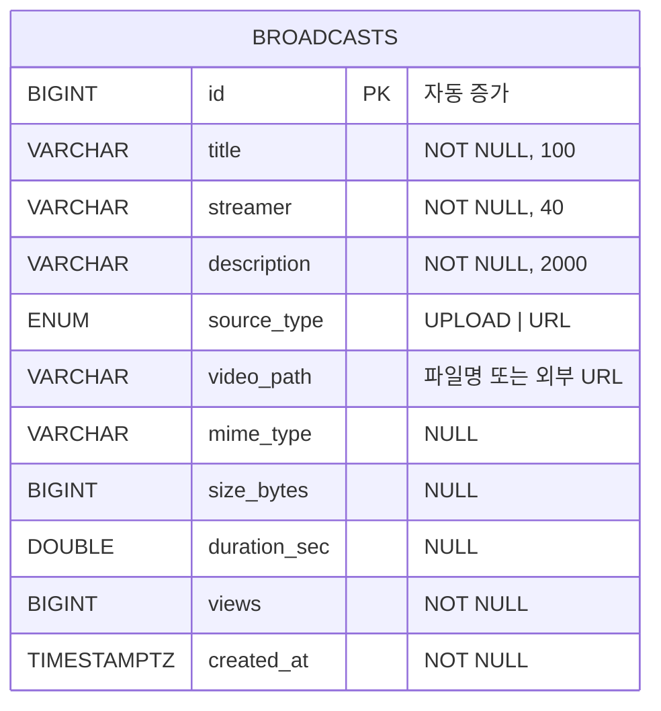

# 치지직 1단계 설계 문서

> 범위: 로그인 없이 녹화 방송을 등록하고 시청하는 기능 (등록 · 목록 · 상세 · 재생 · 영구 저장)
> 기준 커밋: `598b927` · Spring Boot 4.1.2 / Java 17+ / H2 2.4

---

## 1. 시스템 아키텍처

### 1-1. 전체 구조

프론트엔드·백엔드·DB가 **하나의 Spring Boot 프로세스** 안에서 동작합니다.
화면(정적 파일)도 같은 서버가 내려주므로 CORS 설정이나 별도 프론트 서버가 필요 없습니다.

```
┌──────────────────────────── 브라우저 ────────────────────────────┐
│  index.html (목록)   watch.html (상세·플레이어)   upload.html (등록) │
│        │  fetch / XHR (JSON, multipart)        │  <video src>       │
└────────┼───────────────────────────────────────┼───────────────────┘
         │ /api/**                               │ /media/** (Range 요청)
         ▼                                       ▼
┌──────────────────────── Spring Boot (Tomcat) ─────────────────────┐
│                                                                   │
│  [Static]  src/main/resources/static/*  ── 화면 파일 제공           │
│                                                                   │
│  BroadcastController  ── HTTP 요청/응답 (REST, 상태코드)            │
│          │                                                        │
│  BroadcastService     ── 입력 검증, 파일 저장, 트랜잭션              │
│      │            │                                               │
│      │            └──── 파일 쓰기 ───────────┐                     │
│  BroadcastRepository (Spring Data JPA)       │                    │
│      │                                       │                    │
│  GlobalExceptionHandler ── 모든 오류 → {"error": "..."}            │
│  MediaConfig ── /media/** → 업로드 폴더 (ResourceHttpRequestHandler)│
└──────┼───────────────────────────────────────┼────────────────────┘
       │ JDBC (Hibernate)                      │ 파일 시스템
       ▼                                       ▼
┌────────────────────────┐          ┌──────────────────────────────┐
│ H2 파일 DB              │          │ data/uploads/                │
│ data/chzzk.mv.db   │          │ 1793...-8eb9d2d063be.mp4 ... │
│ (방송 메타데이터)        │          │ (실제 영상 바이너리)           │
└────────────────────────┘          └──────────────────────────────┘
```

**핵심 설계 원칙: 메타데이터와 바이너리를 분리 저장**
- DB에는 제목·스트리머·영상 위치(파일명 또는 URL) 같은 **작은 정보**만 저장합니다.
- 영상 바이너리는 파일 시스템에 둡니다. DB에 BLOB으로 넣으면 DB 파일이 커지고, 재생할 때마다 DB에서 큰 데이터를 읽어야 하며, Range(구간) 응답을 직접 구현해야 합니다.

### 1-2. 계층별 역할

| 계층 | 파일 | 책임 |
| --- | --- | --- |
| 화면 | `static/index.html`, `watch.html`, `upload.html`, `common.js`, `style.css` | 목록 렌더링, 플레이어, 등록 폼(미리보기·재생 길이 측정·업로드 진행률) |
| Controller | `broadcast/BroadcastController.java` | URL 매핑, 파라미터 바인딩, 상태코드(201/400/404) |
| Service | `broadcast/BroadcastService.java` | 검증, 업로드 파일 저장, 저장 실패 시 파일 정리, 트랜잭션 경계 |
| Repository | `broadcast/BroadcastRepository.java` | JPA 쿼리 (`findAllByOrderByIdDesc`, `findById`, `save`) |
| Entity / DTO | `Broadcast.java`, `BroadcastResponse.java` | DB 매핑 / API 응답 형태 (엔티티를 그대로 노출하지 않음) |
| 공통 | `common/ApiException.java`, `GlobalExceptionHandler.java` | 예외 → 일관된 JSON 오류 응답 |
| 설정 | `config/MediaConfig.java`, `application.properties` | 업로드 폴더 생성, `/media/**` 매핑, 환경변수 기본값 |

### 1-3. 주요 요청 흐름

**① 방송 등록 (파일 업로드)**
```
upload.html ──POST /api/broadcasts (multipart: title, video, durationSec…)──▶ Controller
  ▶ Service: 제목/길이/형식 검증 ─ 실패 → 400 {"error"}
  ▶ Service: data/uploads/{시각}-{랜덤}.mp4 로 스트림 복사
  ▶ Repository.saveAndFlush(Broadcast)  ─ 실패 → 방금 쓴 파일 삭제 후 오류
  ◀ 201 {id, videoUrl:"/media/…", …}
upload.html ── location → watch.html?id={id}
```

**② 방송 등록 (영상 주소 연결)**
```
POST /api/broadcasts (title, videoUrl) ▶ http/https·호스트 검증 ▶ DB 저장(source_type=URL) ◀ 201
```

**③ 목록 / 상세 / 재생**
```
index.html ── GET /api/broadcasts         ◀ [최신순 목록 JSON]
watch.html ── GET /api/broadcasts/{id}    ◀ {title, videoUrl, …}
           ── POST /api/broadcasts/{id}/views (조회수 +1)
<video>    ── GET /media/{파일명}  Range: bytes=0-   ◀ 206 Partial Content (구간 단위)
```

### 1-4. API 요약

| 메서드 | 경로 | 응답 |
| --- | --- | --- |
| GET | `/api/broadcasts` | 200 목록 (최신순) |
| GET | `/api/broadcasts/{id}` | 200 상세 / 404 |
| POST | `/api/broadcasts` | 201 생성 / 400 검증 실패 |
| POST | `/api/broadcasts/{id}/views` | 200 `{views}` / 404 |
| GET | `/media/{filename}` | 200 / 206(Range) / 404 |

---

## 2. ERD

### 2-1. 테이블 구조

1단계는 인증·댓글·도네이션이 범위 밖이라 **테이블 1개(`broadcasts`)**로 충분합니다.
아래는 Hibernate가 실제로 생성한 스키마를 H2 `INFORMATION_SCHEMA`에서 조회해 정리한 것입니다.

```
┌──────────────────────────────────────────────────────────────────────┐
│ broadcasts                                                           │
├──────────────┬──────────────────────────┬──────┬─────────────────────┤
│ 컬럼          │ 타입                      │ NULL │ 설명                 │
├──────────────┼──────────────────────────┼──────┼─────────────────────┤
│ id  (PK)     │ BIGINT IDENTITY          │  N   │ 방송 번호(자동 증가)  │
│ title        │ VARCHAR(100)             │  N   │ 제목                 │
│ streamer     │ VARCHAR(40)              │  N   │ 스트리머 이름 (빈 값 허용) │
│ description  │ VARCHAR(2000)            │  N   │ 설명 (빈 값 허용)     │
│ source_type  │ ENUM('UPLOAD','URL')     │  N   │ 영상 출처 구분        │
│ video_path   │ VARCHAR(2048)            │  N   │ UPLOAD: 저장 파일명 / URL: 외부 주소 │
│ mime_type    │ VARCHAR(255)             │  Y   │ 업로드 파일 MIME (video/mp4 …) │
│ size_bytes   │ BIGINT                   │  Y   │ 업로드 파일 크기      │
│ duration_sec │ DOUBLE PRECISION         │  Y   │ 재생 길이(초)         │
│ views        │ BIGINT                   │  N   │ 조회수 (기본 0)       │
│ created_at   │ TIMESTAMP WITH TIME ZONE │  N   │ 등록 시각 (UTC Instant) │
└──────────────┴──────────────────────────┴──────┴─────────────────────┘
인덱스: PRIMARY KEY(id)
```



### 2-2. 설계 포인트

- **`source_type` + `video_path` 하나로 두 가지 등록 방식 표현**: 업로드 파일과 외부 URL을 별도 테이블로 나누지 않고, 구분 컬럼으로 처리했습니다. API 응답에서 `UPLOAD`면 `/media/{video_path}`, `URL`이면 원래 주소를 `videoUrl`로 내려주므로 프론트는 출처를 신경 쓰지 않고 `<video src>`에 넣기만 하면 됩니다.
- **파일 경로가 아닌 파일명만 저장**: 업로드 폴더(`UPLOAD_DIR`)를 옮겨도 DB를 고칠 필요가 없습니다.
- **`mime_type`·`size_bytes`는 업로드일 때만 값이 있어 NULL 허용**, `duration_sec`은 측정 실패 가능성이 있어 NULL 허용.
- **`created_at`은 `Instant`(UTC)로 저장**하고 표시할 때 브라우저가 한국 시간으로 바꿉니다.

### 2-3. 관계 (다음 단계 확장 시)

현재는 관계가 없습니다. 다음 단계에서 기능이 추가되면 `broadcasts`를 중심으로 아래처럼 확장할 수 있습니다. (예상 설계이며 1단계에는 구현하지 않았습니다.)

```
channels (1) ───< broadcasts (N)       채널/스트리머가 여러 방송을 가짐 → broadcasts.streamer 를 channel_id FK로 대체
broadcasts (1) ───< comments (N)       방송별 댓글
broadcasts (1) ───< donations (N)      방송별 후원
users (1) ───< comments / donations    인증 도입 후 작성자 연결
```

---

## 3. 기술적 고민 및 개선

각 항목은 **문제 → 선택한 방법 → 근거/결과** 순서로 적었습니다. 마지막 표는 아직 하지 않은 개선 과제입니다.

### 3-1. 영상 재생 성능: Range 요청 지원

- **문제**: 영상 전체를 한 번에 응답하면 긴 영상은 다 받을 때까지 기다려야 하고, 중간으로 탐색(seek)할 수 없습니다.
- **선택**: 직접 스트리밍 코드를 짜지 않고 Spring의 `ResourceHttpRequestHandler`(`addResourceHandler("/media/**")`)를 사용했습니다. 이 핸들러는 `Range` 헤더를 해석해 `206 Partial Content`로 필요한 구간만 보냅니다.
- **결과**: 브라우저 플레이어가 필요한 구간만 요청하므로 바로 재생되고 탐색도 됩니다. 통합 테스트에서 `Range: bytes=0-99` 요청에 206과 정확히 100바이트가 오는 것을 검증합니다.

### 3-2. 업로드 메모리 사용: 스트림 복사

- **문제**: 업로드 파일을 `byte[]`로 읽으면 1GB 영상은 서버 메모리 1GB를 그대로 차지합니다.
- **선택**: `MultipartFile.getInputStream()` → `Files.copy()`로 디스크에 바로 흘려 씁니다. 최대 크기는 `MAX_UPLOAD_SIZE` 환경변수로 제한하고, 한도 초과 시 `MaxUploadSizeExceededException`을 잡아 400과 안내 메시지를 줍니다.
- **보완**: `server.tomcat.max-swallow-size=-1` — 한도를 넘는 업로드에서 Tomcat이 연결을 끊어 버려 브라우저가 오류 메시지를 못 받는 문제를 막기 위한 설정입니다.

### 3-3. 파일 ↔ DB 정합성

- **문제**: 파일 저장과 DB 저장은 하나의 트랜잭션으로 묶을 수 없습니다. 파일은 썼는데 DB 저장이 실패하면 주인 없는 파일이 남습니다.
- **선택**: 검증을 **파일을 쓰기 전에** 모두 끝내고, 파일 저장 후 `saveAndFlush()`로 DB 오류를 그 자리에서 드러나게 한 뒤, 실패하면 방금 쓴 파일을 지웁니다(보상 처리).
- **파일명**: 원본 파일명을 쓰지 않고 `{시각}-{랜덤 12자리 hex}.{확장자}`로 저장합니다. 같은 이름 덮어쓰기, `../` 같은 경로 조작, 한글·공백 파일명 인코딩 문제를 한 번에 피합니다.

### 3-4. 입력 검증과 오류 응답 일원화

- 제목 필수·100자, 스트리머 40자, 설명 2000자, 파일과 URL 중 정확히 하나, 확장자 + MIME 타입(`video/*`) 이중 확인, URL은 `http/https` + 호스트 필수(`javascript:` 차단).
- 검증은 Service에서 `ApiException`을 던지고, `GlobalExceptionHandler`가 모든 예외를 `{"error": "한국어 메시지"}`로 바꿉니다. 프론트는 `body.error`만 보여주면 되고, 예상 못 한 예외는 로그만 남기고 사용자에게는 일반 메시지를 줍니다(내부 정보 노출 방지).
- `durationSec`를 `Double`로 받으면 잘못된 값이 들어올 때 타입 변환 오류가 나서 엉뚱한 상태코드가 나갔습니다. → 문자열로 받아 Service에서 파싱하고, 잘못된 값은 저장하지 않도록 리팩토링했습니다.

### 3-5. 엔티티와 응답 분리 (DTO)

- 엔티티를 그대로 JSON으로 내보내지 않고 `BroadcastResponse` record로 변환합니다. 저장 형태(`video_path`=파일명)와 응답 형태(`videoUrl`=재생 가능한 주소)가 다르고, 나중에 컬럼이 늘어나도 API가 흔들리지 않습니다.
- `spring.jpa.open-in-view=false`: 화면 렌더링 단계까지 DB 커넥션을 붙잡지 않도록 했습니다. 지연 로딩이 필요한 곳은 Service의 트랜잭션 안에서 끝냅니다.

### 3-6. 리팩토링: Node.js → Spring Boot 전환

- 처음에는 Node.js(Express + SQLite)로 만들었다가, 사용 환경(IntelliJ + Spring Boot)에 맞춰 백엔드를 다시 작성했습니다.
- **API 계약(URL, 요청 필드, 응답 JSON 형태, 오류 형식)을 그대로 유지**해서 프론트엔드 파일은 한 줄도 고치지 않고 `static/` 폴더로 옮기기만 했습니다. 화면과 서버가 API로만 연결되도록 분리해 둔 덕분입니다.

### 3-7. 테스트에서 발견한 버그: 설정 우선순위

- **증상**: 테스트가 임시 폴더를 쓰도록 설정했는데, 실제 개발용 `./data` DB에 테스트 데이터("테스트 방송", "외부 영상")가 쌓였습니다.
- **원인**: `SpringApplicationBuilder.properties(...)`는 **가장 낮은 우선순위의 기본값**이라 `application.properties`의 `app.data-dir`에 덮어씌워졌습니다.
- **해결**: 우선순위가 높은 **명령행 인자**(`run("--app.data-dir=...")`)로 넘기도록 바꿨고, 테스트 후 `./data`가 생기지 않는 것을 확인했습니다.
- 테스트는 실제 서버를 **같은 폴더로 두 번** 띄워 "등록 → 목록 → Range 재생 → 조회수 → 재시작 후 조회"를 검증합니다. 과제의 "재시작 후에도 남는지"를 자동으로 확인하는 장치입니다.

### 3-8. 쿼리 관점 점검

| 쿼리 | 실행 방식 | 평가 |
| --- | --- | --- |
| 목록 `findAllByOrderByIdDesc` | `ORDER BY id DESC` | PK 인덱스를 역순으로 읽으므로 정렬 비용이 없음. 단, 전체 행을 가져옴 → 아래 개선 과제 |
| 상세 `findById` | PK 조회 | 인덱스 단건 조회, 문제 없음 |
| 조회수 증가 | `findById` 후 엔티티 값 +1 → 변경 감지 UPDATE | 단순하지만 동시 요청 시 갱신 손실 가능 → 아래 개선 과제 |

`created_at` 대신 `id`로 정렬한 이유: IDENTITY라 등록 순서와 같고, 별도 인덱스 없이 PK로 정렬할 수 있습니다.

### 3-9. 다음에 할 개선 과제

| 구분 | 현재 상태 | 개선 방향 |
| --- | --- | --- |
| 쿼리 — 조회수 동시성 | 읽고 +1 해서 저장 → 두 요청이 동시에 오면 1만 오를 수 있음 | `@Modifying @Query("update Broadcast b set b.views = b.views + 1 where b.id = :id")` 로 DB에서 원자적으로 증가 |
| 쿼리 — 목록 페이지네이션 | 전체 목록을 한 번에 반환 | `Pageable`(또는 `id < :lastId` 키셋 방식) + 무한 스크롤. 키셋은 데이터가 많아도 OFFSET 비용이 없음 |
| 성능 — 썸네일 | 목록 카드마다 `<video preload="metadata">`로 영상 앞부분을 받아 첫 장면 표시 → 카드가 많으면 요청이 늘어남 | 업로드 시 ffmpeg로 썸네일 JPG 생성 후 `thumbnail_path` 컬럼 추가 |
| 신뢰성 — 재생 길이 | 브라우저가 측정한 값을 받음 (조작 가능) | 서버에서 ffprobe로 측정해 저장 |
| 성능 — 캐시 | `/media/**` 캐시 헤더 기본값 | 파일명이 고유하므로 `Cache-Control: max-age=31536000, immutable` 설정 가능 |
| 구조 — 저장소 추상화 | 로컬 디스크에 직접 저장 | `VideoStorage` 인터페이스로 분리 → S3/오브젝트 스토리지 + CDN 교체 가능 |
| 구조 — DB | H2 파일 DB (설치 불필요, 단일 프로세스) | 운영 단계에서 MySQL/PostgreSQL + Flyway 마이그레이션 (`ddl-auto=update` 대신 스키마 버전 관리) |
| 기능 — 관리 | 수정·삭제 없음 | 인증 도입 단계에서 본인 방송 수정·삭제 + 파일 정리 |
| 호환성 — 코덱 | mp4/webm/ogg/mov 업로드 허용, 브라우저가 못 여는 코덱은 재생 실패 | 업로드 후 H.264/AAC로 트랜스코딩, 장기적으로 HLS 변환 |
