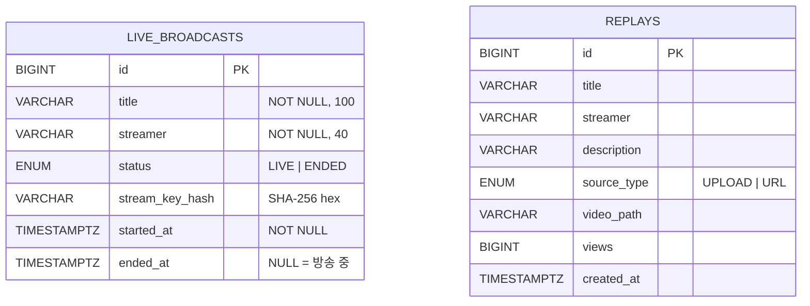

# 치지직 2단계 설계 문서

> 범위: 로그인 없이 휴대폰 카메라·마이크로 **방송**을 시작·종료하고, 시청자가 목록에서 방송을 골라 시청한다. 방송 중·종료 상태를 구분해 표시한다.
> 1단계 기능(다시보기 등록·목록·상세·재생·영구 저장)은 유지한다.
> 용어는 [GLOSSARY.md](../GLOSSARY.md), 주요 결정은 [docs/adr/](adr/) 참고.

---

## 1. 시스템 아키텍처

### 1-1. 전체 구조

**영상은 서버를 거치지 않습니다.** 서버는 방송 기록(DB)과 "누가 누구와 연결할지"에 대한 정보 교환(시그널링)만 맡고, 영상·소리는 휴대폰에서 각 시청자 브라우저로 WebRTC를 통해 직접(P2P) 갑니다.

```
          ┌────────────── 휴대폰 (송출자) ──────────────┐
          │ go-live.html                                │
          │  getUserMedia(카메라·마이크)                  │
          │  RTCPeerConnection × 시청자 수               │
          └───┬──────────────────────┬──────────────────┘
   ① REST     │                      │ ② WebSocket (시그널링)
   방송 시작/종료                     │   offer/answer/ICE 후보 중계
              ▼                      ▼
┌──────────────────────── Spring Boot (Tomcat, HTTPS) ─────────────────────────┐
│  BroadcastController ── BroadcastService ── BroadcastRepository ── H2 DB     │
│        /api/broadcasts      (송출 키 검증,        (live_broadcasts)            │
│                              상태 전이, 정리)                                 │
│                                   │                                          │
│  SignalingHandler  ──────── LiveRooms (메모리)                                │
│   /ws/broadcasts/{id}          방송별 { 송출자 세션 1, 시청자 세션 N }          │
│                                                                              │
│  ReplayController … (1단계 다시보기, /api/replays, /media/**)                 │
└──────────────────────────────────────────────────────────────────────────────┘
              ▲                      ▲
   REST 목록·상세                     │ WebSocket (시그널링)
              │                      │
          ┌───┴──────────────────────┴──────────────────┐
          │ index.html (라이브 목록, 5초 갱신)            │
          │ live.html  RTCPeerConnection 1개             │◀═══ ③ WebRTC 영상·소리 (P2P)
          └────────────── 시청자 브라우저 ───────────────┘     휴대폰에서 직접 수신
                                                        (STUN으로 주소 확인, 필요시 TURN 중계)
```

### 1-2. 구성 요소

| 구성 요소 | 파일 | 책임 |
| --- | --- | --- |
| 송출 화면 | `static/go-live.html` | 카메라·마이크 획득, 방송 시작/종료, 시청자마다 PeerConnection 생성·offer, 카메라 전환·음소거, 화면 켜짐 유지 |
| 시청 화면 | `static/live.html` | offer 수신 → answer, 영상 재생(음소거 시작 → 소리 켜기), 종료·가득 참 표시 |
| 메인 목록 | `static/index.html` | 라이브 영역(방송 중 → 종료, 5초 갱신) + 다시보기 영역 |
| REST | `broadcast/BroadcastController` | 방송 시작(송출 키 발급)·종료(키 확인)·목록·상세 |
| 도메인 서비스 | `broadcast/BroadcastService` | 입력 검증, 상태 전이(방송 중 → 종료), 송출 끊김·미연결·재시작 시 정리 |
| 시그널링 | `broadcast/SignalingHandler` | WebSocket 연결의 역할 판별(송출자/시청자), 메시지 중계, 연결 종료 처리 |
| 방 관리 | `broadcast/LiveRooms` | 방송별 송출자·시청자 세션 보관(메모리), 시청자 수, 상한, 종료 알림 |
| 송출 키 | `broadcast/StreamKeys` | 키 생성(256bit), SHA-256 해시, 상수 시간 비교 |
| WebRTC 설정 | `broadcast/LiveConfigController` | STUN/TURN 목록·시청자 상한을 브라우저에 전달 |

### 1-3. 주요 흐름

**① 방송 시작**
```
휴대폰: 카메라·마이크 켜기(권한 허용) → 미리보기
      → POST /api/broadcasts {title, streamer}
서버  : 송출 키 생성 → 해시만 저장(status=LIVE) → 201 {broadcast, streamKey}
휴대폰: WS /ws/broadcasts/{id} 연결 → {"type":"join","role":"host","streamKey"}
서버  : 키 확인 → 방에 송출자 등록 → (먼저 와 있던 시청자마다) viewer-joined 전송
```

**② 시청 (시청자 1명 기준 WebRTC 연결)**
```
시청자 → 서버 : join(viewer)            ── 상한 초과면 full, 종료된 방송이면 ended
서버 → 송출자 : viewer-joined{viewerId}
송출자        : new RTCPeerConnection, 트랙 추가, offer 생성
송출자 → 서버 → 시청자 : signal{sdp: offer}
시청자 → 서버 → 송출자 : signal{sdp: answer}
양쪽 ↔ 서버 ↔ 양쪽     : signal{candidate} (ICE 후보 교환)
══ 연결 성립 후 영상·소리는 휴대폰 → 시청자로 직접 ══
서버 → 모두   : viewers{count}  (입장·퇴장 때마다)
```

**③ 방송 종료 — 세 가지 경로, 결과는 같음**
```
(a) 종료 버튼        : POST /api/broadcasts/{id}/end  (X-Stream-Key)
(b) 송출 연결 끊김    : 탭 닫기·새로고침·네트워크 단절 → WebSocket close → 즉시 종료
(c) 송출 화면 미연결  : 시작 후 30초 안에 송출자 WS 연결이 없으면 스케줄러가 종료
(+) 서버 재시작       : 기동 시 남아 있는 LIVE 를 모두 ENDED 로
        ↓
DB: status=ENDED, ended_at 기록 → 커밋 후 → 방의 모든 연결에 ended 전송 후 닫기
시청 화면: "방송이 종료되었습니다" + 방송 시간 / 목록: 종료 카드
```

### 1-4. API · 메시지 요약

| 메서드 | 경로 | 설명 |
| --- | --- | --- |
| GET | `/api/broadcasts` | 방송 중(최근 시작 순) → 종료(최근 30개) |
| GET | `/api/broadcasts/{id}` | 상세 (`status`, `viewerCount`) — 송출 키·해시는 절대 미포함 |
| POST | `/api/broadcasts` | 시작 → `201 {broadcast, streamKey}` |
| POST | `/api/broadcasts/{id}/end` | 종료 (`X-Stream-Key`, 틀리면 403, 이미 종료면 그대로 200) |
| GET | `/api/live-config` | `{iceServers, maxViewers}` |
| WS | `/ws/broadcasts/{id}` | 시그널링 |

| 방향 | 메시지 |
| --- | --- |
| 클라이언트 → 서버 | `join{role, streamKey?}`, `signal{to?, data}` |
| 서버 → 송출자 | `viewer-joined{viewerId}`, `viewer-left{viewerId}`, `signal{from, data}`, `viewers{count}`, `ended`, `error` |
| 서버 → 시청자 | `signal{data}`, `viewers{count}`, `full{max}`, `ended` |

---

## 2. ERD

### 2-1. 테이블

2단계에서 **방송(`live_broadcasts`)** 테이블이 추가되고, 1단계 테이블은 용어를 바로잡아 **다시보기(`replays`)** 가 되었습니다.

```
┌─────────────────────────────────────────────────────────────────────────────┐
│ live_broadcasts  (방송: 실시간 송출 한 번의 기록)                              │
├────────────────┬──────────────────────────┬──────┬───────────────────────────┤
│ id  (PK)       │ BIGINT IDENTITY          │  N   │ 방송 번호                  │
│ title          │ VARCHAR(100)             │  N   │ 방송 제목                  │
│ streamer       │ VARCHAR(40)              │  N   │ 표시용 이름 (빈 값 허용)     │
│ status         │ ENUM('LIVE','ENDED')     │  N   │ 방송 상태 (방송 중 / 종료)   │
│ stream_key_hash│ VARCHAR(64)              │  N   │ 송출 키 SHA-256 (원문 미저장) │
│ started_at     │ TIMESTAMP WITH TIME ZONE │  N   │ 시작 시각                  │
│ ended_at       │ TIMESTAMP WITH TIME ZONE │  Y   │ 종료 시각 (방송 중이면 NULL) │
└────────────────┴──────────────────────────┴──────┴───────────────────────────┘

┌─────────────────────────────────────────────────────────────────────────────┐
│ replays  (다시보기: 재생 가능한 녹화 영상) — 1단계 broadcasts 테이블과 동일 구조  │
├────────────────┬──────────────────────────┬──────┬───────────────────────────┤
│ id  (PK)       │ BIGINT IDENTITY          │  N   │                           │
│ title          │ VARCHAR(100)             │  N   │                           │
│ streamer       │ VARCHAR(40)              │  N   │                           │
│ description    │ VARCHAR(2000)            │  N   │                           │
│ source_type    │ ENUM('UPLOAD','URL')     │  N   │ 영상 출처                  │
│ video_path     │ VARCHAR(2048)            │  N   │ 업로드 파일명 / 외부 주소    │
│ mime_type      │ VARCHAR(255)             │  Y   │                           │
│ size_bytes     │ BIGINT                   │  Y   │                           │
│ duration_sec   │ DOUBLE PRECISION         │  Y   │                           │
│ views          │ BIGINT                   │  N   │ 조회수                     │
│ created_at     │ TIMESTAMP WITH TIME ZONE │  N   │                           │
└────────────────┴──────────────────────────┴──────┴───────────────────────────┘
```



### 2-2. 관계와 설계 포인트

- **두 테이블 사이에 관계(FK)는 없습니다.** 방송은 녹화하지 않으므로 방송이 끝나도 다시보기가 생기지 않고, 스트리머는 사람을 식별하지 않는 표시용 이름이라 공통 키가 없습니다. ([ADR-0002](adr/0002-broadcast-and-replay-are-separate.md))
- **시청자 수는 DB에 없습니다.** "지금 이 순간" 값이라 메모리(`LiveRooms`)의 연결 수에서 계산합니다. 누적 값이 아니어서 저장할 이유가 없고, 입장·퇴장마다 UPDATE 하는 비용도 피합니다.
- **송출 키 원문은 저장하지 않습니다.** 응답(`streamKey`)으로 한 번만 내려가고, DB에는 SHA-256 해시만 있습니다. DB가 유출돼도 진행 중인 방송을 종료시키거나 송출자로 위장할 수 없습니다.
- **상태 전이는 한 방향**: `LIVE → ENDED`만 가능하고, `Broadcast.end()`가 두 번째 호출을 무시합니다(멱등).
- 다음 단계 확장 예상 (1단계 문서에서 이어서): `broadcasts (1) ──< comments`, `broadcasts (1) ──< donations`, 인증 도입 후 `users/channels (1) ──< broadcasts, replays`. 방송 녹화를 도입하면 `replays.broadcast_id (FK, NULL 허용)`로 "이 다시보기는 어느 방송에서 왔는지"를 연결할 수 있습니다.

---

## 3. 기술적 고민 및 개선

### 3-1. 송출 방식 선택: WebRTC P2P (ADR-0001)

| 방식 | 지연 | 서버 부담·설치 | 시청자 수 | 녹화 |
| --- | --- | --- | --- | --- |
| **WebRTC P2P (선택)** | < 1초 | 시그널링만, 추가 설치 없음 | 휴대폰 업로드에 비례해 제한 | 없음 |
| MediaRecorder → 서버 → ffmpeg → HLS | 5~10초 | ffmpeg 필요, 서버 CPU 사용 | 제한 없음 | 자연스러움 |
| 외부 미디어 서버(Docker) | 짧음 | Docker 필요 | 많음 | 가능 |

과제 범위(휴대폰 1대 송출, 다른 화면에서 시청)와 "`gradlew bootRun`만으로 실행"을 우선해 P2P를 택했습니다. 그 대가인 **시청자 수 한계**는 숨기지 않고 상한(기본 5명)과 "가득 참" 안내로 드러냈습니다.

### 3-2. 휴대폰 업로드 대역폭 관리

P2P에서는 시청자 N명이면 휴대폰이 영상을 N번 올립니다(1.5Mbps × 5명 ≈ 7.5Mbps).
- **비트레이트 상한**: `RTCRtpSender.setParameters({maxBitrate: 1.5Mbps})`로 시청자별 상한을 둡니다.
- **해상도 요청**: 720p 30fps로 요청해, 휴대폰이 4K로 인코딩하느라 발열·끊김이 생기는 것을 막습니다.
- **시청자 상한**: `MAX_VIEWERS_PER_BROADCAST`(기본 5). 상한 판정과 등록을 방(room) 단위 `synchronized` 안에서 함께 해서, 동시에 들어온 두 시청자가 모두 통과하는 경쟁 상태를 막았습니다.

### 3-3. 시그널링 설계

- **역할은 URL이 아니라 첫 메시지로**: 송출 키를 URL 쿼리에 넣으면 서버·프록시 로그나 브라우저 기록에 남을 수 있습니다. 그래서 연결 후 첫 메시지 `join`으로 역할과 키를 보냅니다. REST 종료 요청도 같은 이유로 헤더(`X-Stream-Key`)를 씁니다.
- **입장 순서 무관**: 시청자가 송출자보다 먼저 들어와도(방송 시작 직후 목록에서 클릭) 대기하고 있다가, 송출자가 연결되는 순간 서버가 대기 중인 시청자마다 `viewer-joined`를 보내 연결이 시작됩니다.
- **ICE 후보 대기열**: 상대의 SDP(offer/answer)를 적용하기 전에 ICE 후보가 먼저 도착하면 `addIceCandidate`가 실패합니다. 원격 SDP가 설정될 때까지 후보를 모아 두었다가 한꺼번에 적용합니다.
- **WebSocket 동시 전송**: Spring의 `WebSocketSession.sendMessage`는 여러 스레드가 동시에 호출하면 안전하지 않습니다. 시청자 입장 알림과 시그널 중계가 다른 스레드에서 같은 송출자 세션으로 갈 수 있으므로 `ConcurrentWebSocketSessionDecorator`로 감쌌습니다.

### 3-4. 송출 키: 로그인 없이 "방송을 연 쪽"만 종료하게

과제는 인증·인가를 요구하지 않지만, 방송 번호만 알면 누구나 남의 방송을 끄거나 송출자로 위장할 수 있으면 서비스가 성립하지 않습니다. 그래서 **사람을 확인하는 인증 대신, 방송 하나에 묶인 권한 증표(capability)** 를 두었습니다.
- 256bit 난수(`SecureRandom`) → Base64URL. 응답에서 한 번만 전달, 브라우저 메모리에만 보관(새로고침 시 방송 종료와 일관).
- DB에는 SHA-256 해시만 저장, 비교는 `MessageDigest.isEqual`(상수 시간)로 타이밍 공격을 피합니다.
- 응답 DTO(`BroadcastResponse`)에는 키 관련 필드가 아예 없고, 테스트에서 상세 응답에 키·해시 문자열이 없는지 검증합니다.

### 3-5. "방송 중"이 영원히 남지 않게: 세 겹의 정리

방송 상태는 DB에 있지만 실제 송출 여부는 휴대폰 연결에 달려 있어서, 둘이 어긋나면 목록에 "유령 방송"이 남습니다.
1. **송출 연결이 끊기면 즉시 종료** — 탭 닫기·새로고침·네트워크 단절 모두 WebSocket close로 감지합니다. (재접속 대기는 이전 시청자 연결을 모두 다시 맺어야 해서 복잡도 대비 이득이 작다고 보고 하지 않았습니다.)
2. **시작만 하고 송출 화면이 붙지 않은 방송** — 10초마다 스케줄러가 "시작 30초가 지났는데 송출자 연결이 없는 방송"을 종료합니다.
3. **서버 재시작** — 메모리의 연결이 모두 사라지므로 기동 시 남은 `LIVE`를 한 번의 UPDATE로 `ENDED` 처리합니다(`@Modifying` 벌크 쿼리, 행마다 조회·저장하지 않음).

### 3-6. 테스트·검증 중 발견해 고친 문제: 커밋 전 알림

- **증상**: 방송을 종료하면 시청 화면과 송출 화면의 요약에 **종료 시각이 비어** 나왔습니다.
- **원인**: 종료 처리 트랜잭션 **안에서** 시청자에게 `ended`를 보냈습니다. 클라이언트가 그 메시지를 받고 곧바로 상세를 다시 조회하면, 아직 커밋 전이라 `ended_at`이 없는 이전 행을 읽었습니다.
- **해결**: `TransactionSynchronization.afterCommit()`에서 알림을 보내도록 바꿨습니다. "DB에 확정된 사실만 밖으로 알린다"는 원칙입니다. 송출 화면은 종료 API 응답과 `ended` 메시지 중 먼저 온 쪽만 처리하도록(한 번만 실행) 정리했습니다.

### 3-7. 휴대폰 브라우저 제약 대응

| 제약 | 대응 |
| --- | --- |
| 카메라·마이크는 HTTPS(또는 localhost)에서만 | `SSL_ENABLED`/`SSL_KEYSTORE`/`SSL_KEYSTORE_PASSWORD` 환경변수로 HTTPS 켜기, JDK `keytool` 자체 서명 인증서 안내. 대안으로 cloudflared 터널. 보안 컨텍스트가 아니면 송출 화면에 원인과 해결 방법을 표시 |
| 소리 있는 영상은 사용자 동작 없이 자동재생 불가 | 시청 화면은 음소거로 즉시 재생하고 **소리 켜기** 버튼 제공 |
| 화면이 꺼지면 카메라가 멈춤 | Screen Wake Lock 요청, 화면 복귀 시 재요청 |
| 카메라 전환 시 끊김 | 새 트랙을 받아 각 연결의 `RTCRtpSender.replaceTrack()`으로 교체 — 재협상(offer/answer) 없이 시청자 화면이 바로 바뀜 |
| 다른 네트워크 간 연결 | STUN 기본 제공, TURN은 환경변수로 선택 설정, 실패 시 시청 화면에 원인 안내 |

### 3-8. 리팩토링: 용어와 코드 일치 (Broadcast → Replay)

1단계에서 녹화 영상을 `Broadcast`라고 불렀는데, 2단계에서 "방송 = 실시간 송출"이 생기면서 같은 단어가 두 뜻을 갖게 됐습니다. 용어집을 먼저 확정하고 코드를 맞췄습니다.
- 1단계 패키지 `broadcast` → `replay` (`Replay`, 테이블 `replays`, `/api/replays`, `replay.html`) — `git mv`로 이력 유지
- 새 방송은 `Broadcast`, 테이블 이름은 기존 개발 DB의 1단계 `broadcasts` 테이블과 충돌하지 않도록 `live_broadcasts`
- 1단계 화면과 테스트는 경로만 바꿔 그대로 통과합니다.

### 3-9. 다음에 할 개선 과제

| 구분 | 현재 상태 | 개선 방향 |
| --- | --- | --- |
| 확장성 | P2P라 방송당 시청자 5명 안팎 | SFU(LiveKit, mediasoup 등)로 교체: 휴대폰은 1번만 올리고 서버가 복제. 시그널링 메시지와 방송/시청자 개념은 유지하고 미디어 경로만 바꿀 수 있게 `LiveRooms`를 분리해 둠 |
| 녹화 | 종료된 방송은 기록만 남음 | 송출 중 휴대폰 `MediaRecorder` 녹화 → 종료 시 다시보기 업로드, 또는 SFU 서버 녹화. `replays.broadcast_id` 연결 |
| 재접속 | 송출 끊김 = 즉시 종료 | 짧은 유예(예: 15초) 동안 같은 송출 키로 재접속하면 이어서 방송, 시청자에게 "재연결 중" 표시 |
| 목록 갱신 | 5초 폴링 | 목록용 WebSocket/SSE로 방송 시작·종료를 즉시 푸시 |
| 쿼리 | 방송 중 목록을 `status`로 조회 (인덱스 없음) | 방송 수가 늘면 `(status, started_at)`, `(status, ended_at)` 복합 인덱스 |
| 썸네일 | 라이브 카드는 스트리머 이름만 표시 | 송출 화면이 주기적으로 캔버스 캡처를 올려 라이브 썸네일 제공 |
| 네트워크 | TURN은 정적 계정(브라우저에 노출) | TURN REST API 방식의 단기 자격 증명 발급 |
| 운영 | 자체 서명 인증서 | 실제 도메인 + Let's Encrypt, 리버스 프록시(Nginx)에서 TLS 종료 |
