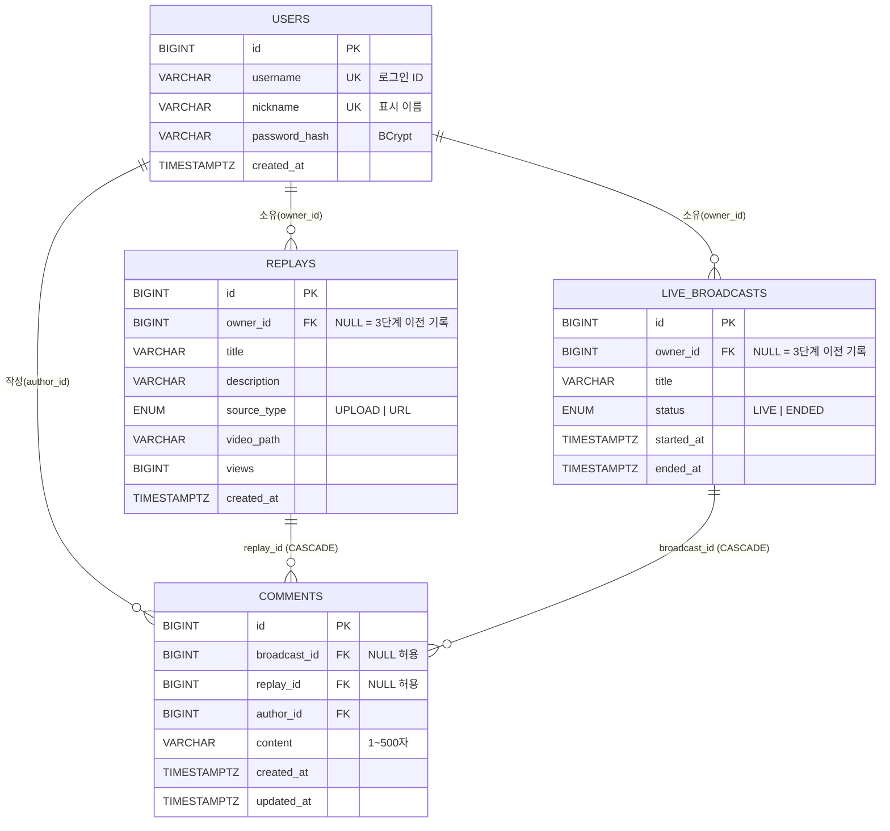

# 치치직 3단계 설계 문서

> 범위: 회원가입·로그인·로그아웃, 방송·다시보기의 **소유자** 구분과 서버 권한 검사(등록·수정·삭제·송출 제어), 로그인 사용자의 **댓글**(작성·목록·수정·삭제).
> 1·2단계 기능(다시보기, 휴대폰 라이브 송출·시청)은 유지한다.
> 용어는 [GLOSSARY.md](../GLOSSARY.md), 주요 결정은 [ADR-0003 세션 인증](adr/0003-session-auth-with-spring-security.md), [ADR-0004 송출 키 → 소유자 검사](adr/0004-owner-check-replaces-stream-key.md).

---

## 1. 시스템 아키텍처

### 1-1. 전체 구조

2단계 구조에 **Spring Security 필터 체인**이 앞단에 들어오고, 사용자·댓글 모듈이 추가되었습니다. 로그인 상태는 서버 세션에 있고 브라우저는 세션 쿠키(`JSESSIONID`)만 갖습니다. 같은 쿠키가 REST 요청과 WebSocket 연결 요청에 모두 실려 오므로, 서버는 두 경로에서 같은 방식으로 "누구인지"를 압니다.

```
 브라우저 (비로그인 / 로그인)                                   휴대폰 (스트리머 = 소유자)
 index · auth · replay · live · upload                          go-live
   │  쿠키 JSESSIONID + 헤더 X-CSRF-TOKEN                          │ 쿠키 JSESSIONID
   ▼                                                              ▼
┌──────────────────────────── Spring Boot ──────────────────────────────────────────┐
│ ① Security 필터 체인 (1차 관문: "로그인했는가")                                      │
│    · GET /api/**, 화면, /media/**, /ws/** ........ 공개                             │
│    · POST/PATCH/DELETE /api/** ................... 로그인 필수 → 아니면 401          │
│    · 상태 변경 요청 .............................. CSRF 토큰 필수 → 아니면 403        │
│    · 세션에서 SecurityContext 복원 → LoginUser(id, nickname)                         │
│                                                                                    │
│ ② 컨트롤러 (@AuthenticationPrincipal LoginUser me)                                 │
│    AuthController  ReplayController  BroadcastController  CommentController        │
│                                                                                    │
│ ③ 서비스 (2차 관문: "누구의 것인가") ── Ownership.requireOwner(owner, me) → 403      │
│    UserService     ReplayService      BroadcastService     CommentService          │
│         │               │                  │      │              │                 │
│         ▼               ▼                  ▼      │              │ 방송 중이면       │
│    UserRepository  ReplayRepository  BroadcastRepository        │ 커밋 후 알림      │
│                                                   │              ▼                 │
│ ④ SignalingHandler (/ws/broadcasts/{id}) ────── LiveRooms (메모리: 송출자 1 + 시청자 N)│
│    송출자 join 시 WebSocket 세션의 Principal == 방송 소유자 확인 → 아니면 error·종료   │
│    방 전체에 comment / title / ended 알림 전송                                       │
└──────────────┬─────────────────────────────────────────────────────────────────────┘
               ▼
        H2 파일 DB: users · replays · live_broadcasts · comments  (+ data/uploads 영상 파일)

 영상·소리: 휴대폰 ══WebRTC P2P══▶ 시청자 브라우저 (서버를 거치지 않음, 2단계와 동일)
```

### 1-2. 권한 검사를 두 겹으로 둔 이유

| 단계 | 위치 | 질문 | 실패 시 |
| --- | --- | --- | --- |
| 1차 | `SecurityConfig` (URL·메서드 규칙) | 로그인했는가? | 401 `로그인이 필요합니다.` |
| 2차 | 각 서비스 + `Ownership` | 이 대상의 소유자/작성자인가? | 403 `…권한이 없습니다.` |

"로그인 여부"는 URL만 보고 판단할 수 있어 필터에서 한 번에 막고, "누구의 것인가"는 DB에서 대상을 읽어야 알 수 있으므로 서비스에서 판단합니다. 서비스도 `me == null`이면 401을 던지므로, 필터 규칙을 실수로 열어도 서비스가 다시 막습니다(방어 심층화). 화면의 버튼 숨김은 이 두 겹과 무관한 **편의 기능**입니다.

### 1-3. 주요 흐름

**① 회원가입·로그인**
```
화면 로드 → GET /api/auth/me → {user:null, csrf:{headerName, token}}   (CSRF 토큰은 세션에 저장)
POST /api/auth/signup {username,password,nickname} + X-CSRF-TOKEN
  → 검증(형식·중복) → BCrypt 해시 저장 → AuthenticationManager 로 인증
  → request.changeSessionId()  (세션 고정 방지)
  → SecurityContext 를 세션에 저장 → 새 CSRF 토큰 발급 → 201 {user, csrf}
POST /api/auth/logout + X-CSRF-TOKEN → 세션 무효화 → 204
```

**② 다른 사용자가 남의 다시보기를 수정하려 할 때**
```
PATCH /api/replays/1 (쿠키: 다른 사용자, CSRF 정상)
  필터: 로그인됨 → 통과
  ReplayService.edit: findWithOwnerById(1) → owner.id(=A) ≠ me.id(=B) → 403
  DB 변경 없음
```

**③ 방송 송출 연결 (WebSocket)**
```
go-live.html: POST /api/broadcasts {title} → 201 (owner = 로그인 사용자)
WS /ws/broadcasts/{id} 연결 (핸드셰이크에 세션 쿠키 → Principal 설정)
→ {"type":"join","role":"host"}
SignalingHandler: canHost(id, principal) = 방송 중 && owner == principal ?
   예 → 송출자 등록 / 아니오 → {"type":"error"} 후 연결 종료
```

**④ 방송 중 댓글**
```
시청자: POST /api/broadcasts/{id}/comments {content}   (로그인 필요)
CommentService.create → INSERT → (커밋 후) LiveRooms.sendToAll(id, {type:"comment", action:"created", comment})
송출자 화면·모든 시청자 화면: 목록 맨 위에 즉시 추가
스트리머: DELETE /api/comments/{cid} → 작성자 아님, 하지만 대상 방송의 소유자 → 허용 → 모두에게 deleted 알림
```

---

## 2. ERD

### 2-1. 테이블 (H2 `INFORMATION_SCHEMA`에서 확인한 실제 스키마)

```
┌──────────────────────── users ────────────────────────┐
│ id (PK)        BIGINT IDENTITY                         │
│ username       VARCHAR(20)  NOT NULL  UNIQUE  로그인 ID │
│ nickname       VARCHAR(20)  NOT NULL  UNIQUE  표시 이름 │
│ password_hash  VARCHAR(100) NOT NULL  BCrypt           │
│ created_at     TIMESTAMPTZ  NOT NULL                   │
└───────────┬───────────────────────────┬────────────────┘
            │ 1                         │ 1
            │ owner_id (NULL 허용)       │ owner_id (NULL 허용)
            ▼ N                         ▼ N
┌──── replays (다시보기) ─────┐   ┌──── live_broadcasts (방송) ────┐
│ id (PK)                     │   │ id (PK)                        │
│ owner_id (FK → users)       │   │ owner_id (FK → users)          │
│ title, description          │   │ title                          │
│ source_type, video_path …   │   │ status  ENUM(LIVE, ENDED)      │
│ views, created_at           │   │ started_at, ended_at           │
└─────────────┬───────────────┘   └───────────────┬────────────────┘
              │ 1                                 │ 1
              │ replay_id (NULL 허용)              │ broadcast_id (NULL 허용)
              │ ON DELETE CASCADE                 │ ON DELETE CASCADE
              ▼ N                                 ▼ N
        ┌──────────────────────── comments ─────────────────────────┐
        │ id (PK)        BIGINT IDENTITY                             │
        │ broadcast_id   BIGINT  FK → live_broadcasts  ┐ 둘 중 정확히 │
        │ replay_id      BIGINT  FK → replays          ┘ 하나만 값    │
        │ author_id      BIGINT  NOT NULL FK → users  ON DELETE CASCADE │
        │ content        VARCHAR(500) NOT NULL                       │
        │ created_at     TIMESTAMPTZ NOT NULL                        │
        │ updated_at     TIMESTAMPTZ (수정 시각, NULL = 수정 안 함)    │
        │ INDEX idx_comments_broadcast (broadcast_id, id)            │
        │ INDEX idx_comments_replay    (replay_id, id)               │
        └────────────────────────────────────────────────────────────┘
                      ▲ N
                      │ author_id
                      └──────────── users (1)
```



### 2-2. 설계 포인트

- **소유자 = FK 한 칸**: 방송·다시보기의 `owner_id`가 권한 판단의 유일한 근거입니다. 2단계의 자유 입력 `streamer` 문자열은 사칭이 가능해 버렸고, 화면의 스트리머 이름은 `owner.nickname`에서 가져옵니다.
- **`owner_id`는 NULL 허용**: 3단계 이전 DB를 그대로 쓰면 소유자가 없는 행이 있습니다. `Ownership.isOwner(null, me)`는 항상 false라서 누구도 고칠 수 없고, 화면에는 "익명"으로 보입니다.
- **댓글 대상은 두 개의 nullable FK**: `target_type + target_id` 같은 다형 컬럼 대신 실제 FK 두 개를 두어, DB가 참조 무결성과 **ON DELETE CASCADE**를 보장합니다. 다시보기·방송 기록을 지우면 댓글이 DB에서 함께 지워지므로 애플리케이션에서 "댓글 먼저 지우기" 순서를 신경 쓸 필요가 없습니다. "둘 중 정확히 하나" 규칙은 엔티티 생성 메서드(`Comment.onBroadcast` / `onReplay`)만 열어 두어 코드에서 지킵니다.
- **사용자 삭제(탈퇴)는 이번 범위가 아니지만** `author_id`도 CASCADE로 두어, 나중에 탈퇴를 넣을 때 댓글 정리가 자동으로 됩니다. 반면 `owner_id`는 NO ACTION — 탈퇴한 사용자의 방송·다시보기를 어떻게 할지(삭제? 익명화?)는 정책 결정이 필요해 일부러 자동 처리하지 않았습니다.
- **로그인 아이디와 닉네임 분리**: 응답에는 `owner{id, nickname}`, `author{id, nickname}`만 나가고 `username`은 본인의 `/api/auth/me` 외에는 노출하지 않습니다. 로그인 ID를 알면 비밀번호 대입 공격의 절반이 풀리기 때문입니다.

---

## 3. 기술적 고민 및 개선

### 3-1. 세션 vs JWT (ADR-0003)

화면·API·WebSocket을 한 서버가 제공하는 구조라 **서버 세션 + 쿠키**를 택했습니다.
- 브라우저가 쿠키를 자동으로 보내므로 WebSocket 핸드셰이크에서도 별도 토큰 전달 없이 사용자를 압니다. (JWT라면 쿼리 문자열에 토큰을 넣어야 해서 로그에 남는 문제가 생깁니다.)
- 로그아웃 = 서버에서 세션 삭제 → **즉시** 무효. JWT는 만료 전까지 유효해 차단 목록이 필요합니다.
- 쿠키는 `HttpOnly`(스크립트에서 못 읽음), `SameSite=Lax`, HTTPS 실행 시 `Secure`.
- 대가: 서버를 여러 대로 늘리면 세션 저장소 공유(Spring Session + Redis)가 필요합니다.

### 3-2. CSRF: 쿠키 인증의 짝

쿠키는 다른 사이트에서 보낸 요청에도 자동으로 붙으므로, 상태를 바꾸는 요청에는 **CSRF 토큰**을 요구합니다.
- 토큰은 서버 세션에 저장하고(`HttpSessionCsrfTokenRepository`), 화면은 `/api/auth/me` 응답으로 받아 `X-CSRF-TOKEN` 헤더로 보냅니다. 다른 사이트는 이 응답을 읽을 수 없으므로(동일 출처 정책) 토큰을 알 수 없습니다.
- 쿠키에 토큰을 두는 방식(`CookieCsrfTokenRepository`) 대신 세션을 택해, JS가 읽을 수 있는 쿠키를 하나도 만들지 않았습니다.
- **로그인 직후 토큰 재발급**: 로그인 전 토큰을 계속 쓰면 공격자가 미리 심어 둔 토큰이 로그인 후에도 유효할 수 있어, 로그인 응답에서 새 토큰을 내려줍니다.
- 공통 `chi.api()`가 POST/PATCH/DELETE에 토큰을 자동으로 붙이고, 진행률이 필요한 업로드(XHR)에도 같은 헤더를 붙였습니다.
- 테스트: 로그인한 사용자라도 토큰 없이 보내면 403인지 확인합니다.

### 3-3. 권한 검사를 한 곳으로: `Ownership`

수정·삭제·종료·송출·댓글 삭제마다 "소유자인가"를 각자 구현하면 한 곳만 빠뜨려도 구멍이 됩니다. `Ownership.isOwner / requireOwner / requireLogin` 세 함수로 모았고, 판단 기준은 **ID 비교 하나**입니다(`owner.id == me.id`, 소유자 없음은 항상 false).
- 댓글 삭제는 규칙이 OR라서(`작성자 || 대상의 소유자`) 서비스에서 `isOwner` 두 번으로 명시적으로 썼습니다.
- 권한 판단에 필요한 연관(댓글 → 작성자, 대상 → 대상 소유자)은 **fetch join 한 번**(`findForPermission`)으로 가져와, 권한 검사 때문에 쿼리가 여러 번 나가지 않게 했습니다.

### 3-4. 송출 키 제거: 권한 경로를 하나로 (ADR-0004)

2단계의 송출 키는 "로그인이 없을 때의 대용품"이었습니다. 로그인이 생긴 뒤에도 남겨 두면 **권한을 증명하는 길이 둘**(키 또는 소유자)이 되어, 한쪽 검사만 고쳐도 다른 쪽으로 우회될 수 있습니다. 키 발급·해시·헤더를 모두 지우고, REST 종료와 WebSocket 송출 연결 모두 `canHost / requireOwner` 소유자 검사로 통일했습니다. WebSocket은 핸드셰이크 때 Spring Security가 넣어 준 `Principal`을 `WebSocketSession.getPrincipal()`로 읽습니다.

### 3-5. 쿼리 최적화

| 쿼리 | 문제 | 처리 |
| --- | --- | --- |
| 다시보기·방송 목록에서 스트리머 닉네임 | 목록 N개 × 소유자 조회 = **N+1** | `@EntityGraph(attributePaths = "owner")`로 한 번의 JOIN |
| 댓글 목록 + 작성자 닉네임 | 동일한 N+1 | `@EntityGraph("author")` |
| 댓글 페이지네이션 | `OFFSET`은 뒤 페이지일수록 앞의 행을 모두 읽고 버림 | **키셋**: `WHERE broadcast_id=? AND id < :before ORDER BY id DESC LIMIT n` + 복합 인덱스 `(broadcast_id, id)` → 인덱스 범위만 읽음. 새 댓글이 계속 달리는 방송 중에도 페이지가 밀리지 않음 |
| 권한 검사용 댓글 조회 | 댓글 → 대상 → 대상 소유자를 차례로 지연 로딩하면 3~4회 쿼리 | `findForPermission` fetch join 1회 |
| 대상 삭제 시 댓글 정리 | 댓글을 읽어서 하나씩 지우면 댓글 수만큼 DELETE | DB `ON DELETE CASCADE` — 대상 DELETE 1회로 끝 |

관찰: H2는 FK마다 단일 컬럼 인덱스를 자동으로 만들어서, `broadcast_id` 단독 인덱스가 복합 인덱스 `(broadcast_id, id)`와 중복됩니다. 운영 DB로 옮길 때 마이그레이션 도구로 인덱스를 직접 관리하면 정리할 항목입니다.

### 3-6. 실시간 댓글: 저장은 REST 하나, 알림은 커밋 후

- 댓글 쓰기 경로를 REST 하나로만 두었습니다. WebSocket으로도 댓글을 받으면 검증·권한·CSRF를 두 군데에서 맞춰야 하기 때문입니다. WebSocket은 **알림 전용**입니다.
- 알림은 `AfterCommit.run(...)`으로 **DB 커밋이 끝난 뒤** 보냅니다. 2단계에서 "종료 알림이 커밋보다 먼저 나가 종료 시각이 비어 보이던" 버그를 겪은 뒤 만든 공통 도구로, 방송 종료·제목 변경·댓글 알림과 다시보기 파일 삭제가 모두 이 규칙을 따릅니다(롤백되면 아무 알림도, 파일 삭제도 일어나지 않음).
- 알림 내용에는 권한 정보(수정 가능 여부 등)를 넣지 않았습니다. 받는 사람마다 다르기 때문에, 각 화면이 `author.id`와 자기 `me.id`를 비교해 버튼을 그리고, 실제 허용은 서버가 다시 판단합니다.

### 3-7. 비밀번호와 계정 보안

- **BCrypt** 저장(솔트 포함, 의도적으로 느린 해시). BCrypt는 72바이트까지만 쓰므로 비밀번호 상한을 72자로 두어 "뒷부분이 무시되는" 혼란을 막았습니다.
- 로그인 실패 메시지는 "아이디 또는 비밀번호가 올바르지 않습니다" 하나로 통일해, 아이디 존재 여부를 알려주지 않습니다. (`DaoAuthenticationProvider`는 없는 아이디에도 해시 비교를 수행해 응답 시간 차이도 줄입니다.)
- 세션에 저장하는 `LoginUser`에서는 인증이 끝나면 비밀번호 해시를 지웁니다(`withoutPassword()`).
- 아이디·닉네임 중복은 먼저 조회해 친절한 메시지를 주고, 동시에 같은 값으로 가입하는 경우는 DB **UNIQUE 제약**이 최종 방어선이 되어 409로 변환합니다.
- 로그인 후 이동할 `next` 주소는 사이트 내부 경로(`/`로 시작, `//` 제외)만 허용해 **오픈 리다이렉트**를 막았습니다.

### 3-8. 이전 단계 DB 호환

엔티티에서 `streamer`, `stream_key_hash` 컬럼을 뺐지만 Hibernate `ddl-auto=update`는 컬럼을 지우지 않습니다. 이전 DB에서는 이 컬럼들이 `NOT NULL`로 남아 **새 행 INSERT가 실패**합니다. `LegacySchemaCleanup`이 기동 시 `INFORMATION_SCHEMA`를 확인해 해당 제약만 풀도록 했습니다(데이터는 보존).
- 확인 방법: 2단계 커밋(`58dfe08`)의 jar로 다시보기·방송을 만든 DB에 3단계를 띄워, 기존 행 유지 / 소유자 없음 표시 / 수정 403 / 댓글 가능 / 새 행 등록 가능을 확인했습니다.

### 3-9. 테스트 설계: 역할별 클라이언트

`ApiClient`가 사용자마다 **쿠키 저장소와 CSRF 토큰을 따로** 갖는 테스트용 브라우저 역할을 합니다. 비로그인·소유자·다른 사용자를 각각 만들어 같은 요청을 보내고 401/403/200을 비교하므로, 권한 표의 모든 칸이 실제 HTTP 요청으로 검증됩니다(화면 버튼과 무관). WebSocket도 해당 사용자의 세션 쿠키를 실어 연결해 송출자 권한을 확인합니다.

### 3-10. 다음에 할 개선 과제

| 구분 | 현재 상태 | 개선 방향 |
| --- | --- | --- |
| 무차별 대입 | 로그인 시도 횟수 제한 없음 | 아이디·IP별 실패 횟수 제한(지수 백오프), 일정 횟수 이상이면 일시 잠금 |
| 댓글 도배 | 작성 빈도 제한 없음 | 사용자별 초당 작성 제한, 같은 내용 반복 차단 |
| 무결성 | 댓글 "대상 정확히 하나" 규칙은 코드로만 보장 | DB `CHECK ((broadcast_id IS NULL) <> (replay_id IS NULL))` 추가 |
| 스키마 관리 | `ddl-auto=update` + 호환용 정리 코드 | Flyway 마이그레이션으로 컬럼 삭제·인덱스 정리까지 버전 관리 |
| 세션 확장 | 서버 메모리 세션 (재시작 시 로그아웃) | Spring Session JDBC/Redis로 재시작·다중 서버에도 유지 |
| 실시간 범위 | 방송 중에만 댓글 실시간, 다시보기는 새로고침 | 다시보기 상세에도 SSE로 새 댓글 알림 |
| 계정 기능 | 프로필·비밀번호 변경·탈퇴 없음 | 비밀번호 변경 시 다른 세션 모두 무효화, 탈퇴 시 방송·다시보기 처리 정책 결정 |
| 관리 | 관리자 역할 없음 | `ROLE_ADMIN`으로 신고된 댓글·방송 관리 |
